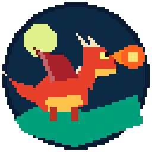
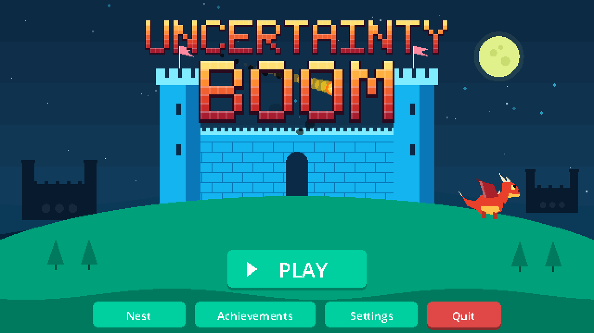
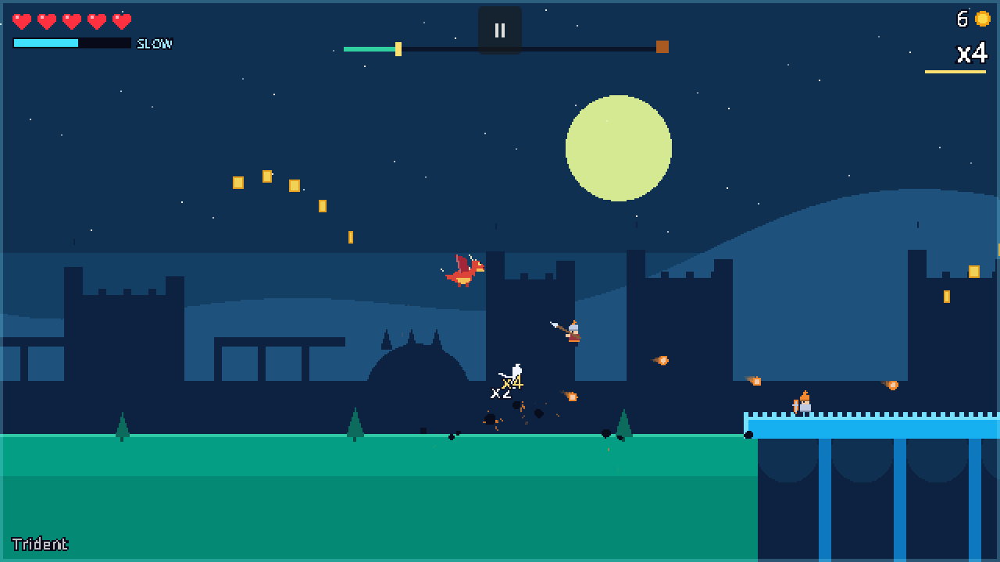
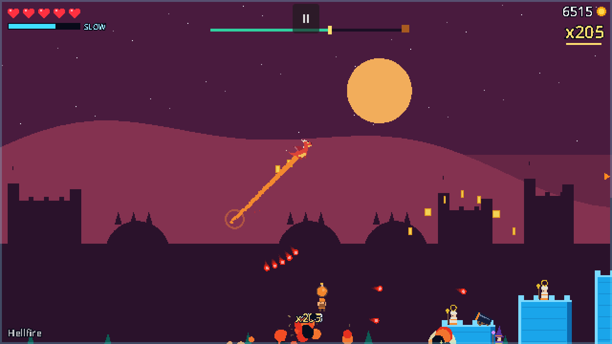
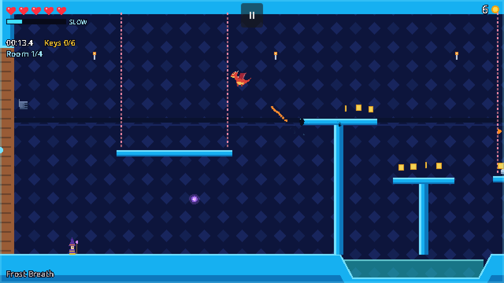
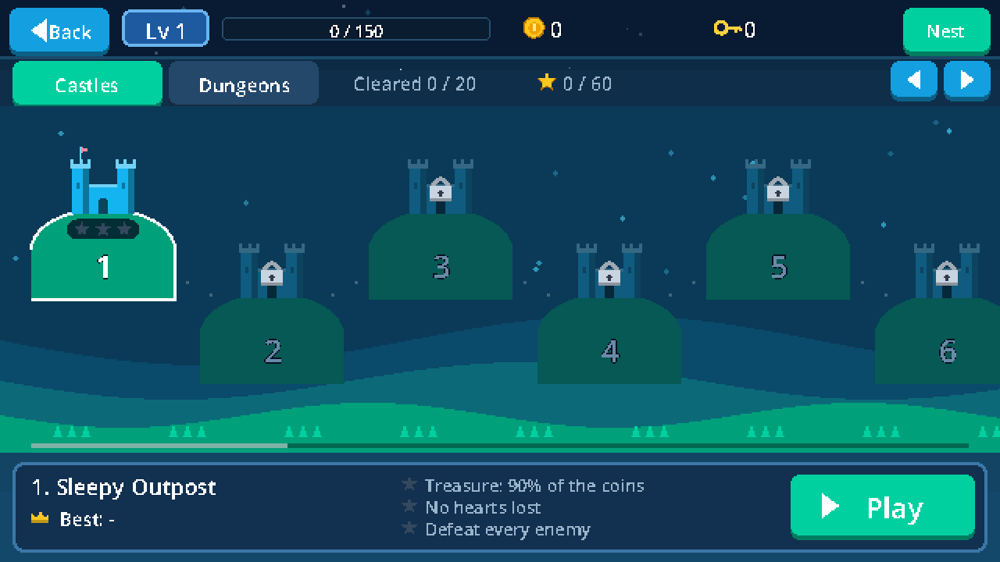
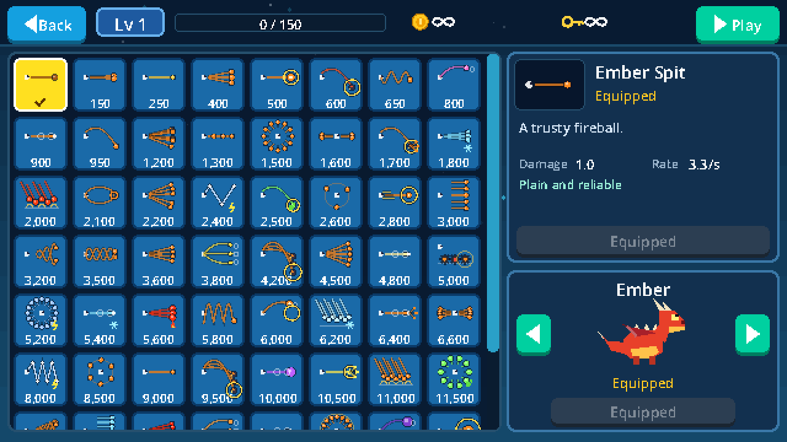

<p align="center">
  
</p>

<h1 align="center">Uncertainty Boom</h1>

<p align="center">
  A small, rebellious dragon dashes through castles and dungeons, roasting knights and hoarding gold.<br>
  A fast 2D arcade action-platformer made with <b>Godot 4.6</b>.
</p>

<p align="center">
  
</p>

## About the game

You are a young dragon with no respect for authority. Dash through the air, juggle soldiers
with fireballs, slow time down to line up the perfect shot, and grab every coin before you
reach the treasure at the end of the level.

Everything you see and hear is made in code: the art is drawn with flat vector shapes and
rendered at 640x360 for a crisp pixel look, and every sound effect and music track is
synthesized at runtime. The project has no image or audio asset files besides its icon.

<p align="center">
  
  
</p>

### Features

- **Dash-and-fall movement.** Dash in any direction, fall, dash again. Dashes are unlimited
  and can cancel each other mid-dash. Slide along the ground, smash-dive into enemies.
- **Slow motion.** Toggle it, or hold right mouse to aim a slingshot dash. The meter refills
  as you hit and defeat enemies.
- **Combos.** Launch enemies into the air and keep hitting them. The combo multiplies the gold they drop.
- **20 castle levels** that scroll to a treasure chest, and **Endless Castles** that generate forever and get harder.
- **20 dungeon levels** of closed rooms with enemy waves, traps, keys and a timer, and an **Endless Dungeon**.
- **22 enemy types**: shield knights, archers, bomb carriers, balloon bombers, mages, clerics,
  ballistas, ghosts, slimes, skeletons and more, plus the Golden Knight and the Warlord bosses.
- **60 attack styles** bought with gold: spreads, homing swarms, lightning chains, orbiting
  embers, storm clouds that rain meteors, black holes that pass through walls…
- **6 cosmetic dragons** bought with keys, a dragon level that grows with all the gold you earn,
  three stars per level and **60 achievements**.
- **Settings**: volume, mute, fullscreen, screen shake, a keyboard-only mode, a creative mode
  for testing (infinite gold and keys, every level unlocked) and save deletion.

<p align="center">
  
  
</p>

## How to play

| Action | Keys |
|---|---|
| Run / steer | A / D |
| Jump (W alone on the ground) | W / Space |
| Dash up, or diagonally up | W + A/D, or W in the air |
| Slide along the ground | S (+ A/D) on the ground |
| Dash diagonally down / smash dive | S + A/D in the air / S alone in the air |
| Dash toward the cursor | Shift |
| Slow motion + slingshot aim | Hold right mouse, release to dash |
| Toggle slow motion | E |
| Breathe fire with your attack style | Left mouse (hold to keep firing) |
| Auto-attack the nearest enemy | R |
| Pause (with settings) | Esc / P |

**Keyboard-only mode** (in Settings) makes Shift dash in your WASD direction, so the game is
fully playable without a mouse.

**Stars.** Castles: collect 90% of the coins, lose no hearts, defeat every enemy.
Dungeons: find every key, reach the combo target, beat the par time.

**Progression.** Every coin you earn raises your dragon level (+4% damage per level) and can be
spent on attack styles in the **Nest**. Keys from dungeons, bosses and treasure chests buy new
dragon skins.

<p align="center">
  
</p>

## Running the game

1. Install [Godot 4.6](https://godotengine.org/download) (the standard build; .NET is not needed).
2. Clone this repository.
3. Open `project.godot` in Godot and press **F5**, or run it directly:

```bash
godot --path "path/to/Uncertainty-Boom"
```

Your save file lives in Godot's user data folder (`%APPDATA%\Godot\app_userdata\Uncertainty Boom` on Windows).

### Export a standalone build

Install the Godot 4.6 export templates (Editor → Manage Export Templates), then:

```bash
godot --headless --path . --export-release "Windows Desktop" build/UncertaintyBoom.exe
```

## Project structure

```
autoload/      Global singletons: Events (signal bus), Game (save, progression, settings), Sfx (synth audio)
data/          Game data tables: 60 attack styles, 22 enemies, 6 dragons, 40 levels, 60 achievements
game/player/   The dragon, its drawing, projectiles and rain clouds
game/enemies/  All 22 enemy behaviours and their projectiles
game/level/    World runner, level generator, terrain chunks, background, pickups, HUD, effects
ui/            Menus: main menu, level map, Nest, settings, achievements, pause, results, toasts
scenes/        main.tscn, the single scene; every screen is built in code
assets/icon/   Game icon (PNG and Windows ICO)
tools/         make_icon.gd: renders the icon from the dragon art
docs/          DESIGN.md (architecture and code contracts) and screenshots
```

## Developer options

Debug flags go after `--` on the command line, for example
`godot --path . -- --level=castle:3 --save=test`.

| Flag | Effect |
|---|---|
| `--screen=nest` | Open a screen directly: `menu`, `levels`, `nest`, `settings`, `achievements` |
| `--level=castle:3`, `--level=dungeon:endless` | Jump straight into a level |
| `--save=test` | Use a separate save file (`user://save_test.dat`) |
| `--creative` | Creative mode for this session |
| `--attack=meteor` | Equip an attack style (use with a test save) |
| `--autoplay` | A simple bot plays the level |
| `--pause`, `--pause=settings` | Open the pause menu (and its settings) after one second |
| `--screenshot=out.png --frames=60 --shotscale=2` | Save a screenshot after N frames, then quit |

Regenerate the icon with `godot --path . --script res://tools/make_icon.gd`.

## Credits

Made by [UncertaintyNihilityOmega](https://github.com/UncertaintyNihilityOmega), built with the
[Godot Engine](https://godotengine.org).

Inspired by the mobile game *Drag'n'Boom* (Ankama, 2017). Uncertainty Boom is an independent
project with its own code, art, levels and characters, and is not affiliated with Ankama.

## License

Code is under the **MIT License** and content (game data, texts, art, icon, screenshots and
documentation) is under **CC BY 4.0**. See [LICENSE](LICENSE) for details.
